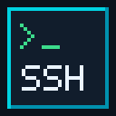
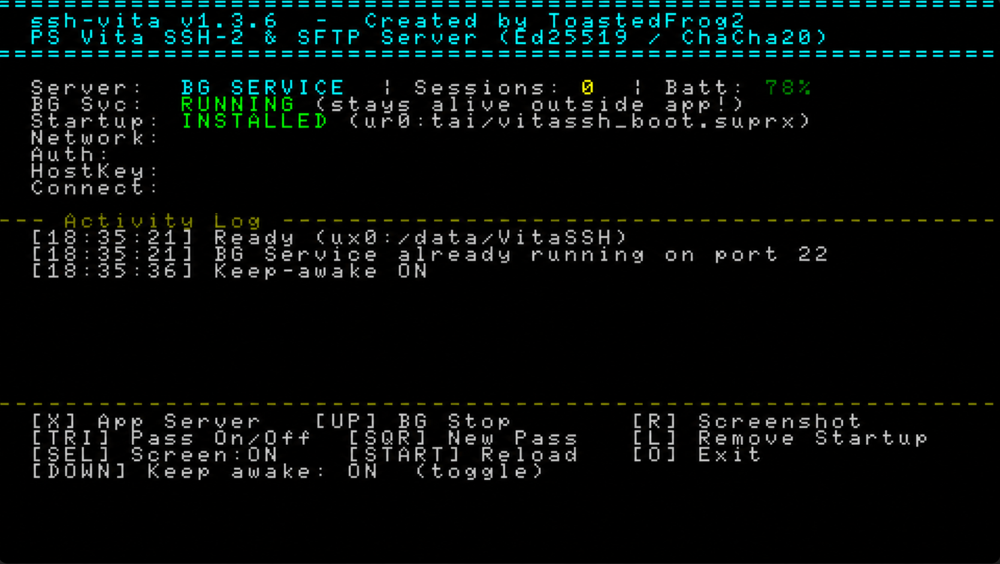

<p align="center">
  
</p>

<h1 align="center">ssh-vita</h1>

SSH and SFTP for homebrew-enabled PlayStation Vita systems.

**Maintained by [ToastedFrog2](https://github.com/ToastedFrog2)**  
**Version:** 1.3.6  
**Tested firmware:** 3.65

<p align="center">
  
</p>

## Features

- SSH-2 terminal access, command execution, and SFTP file transfers.
- Optional background startup with a delayed service launcher.
- Manual keep-awake toggle with D-pad Down; OFF after every reboot.
- Process and module inspection, checked memory tools, and screenshots.
- Timed button, touch, and analog commands.

## Install

1. Download the release ZIP and extract `ssh-vita.vpk`.
2. Transfer the VPK to the Vita and install it with VitaShell.
3. Open **ssh-vita**. The app displays the address, port, and login information.
4. Reboot after an upgrade so the background service and kernel helper match.

Connect using the address and login shown by the app:

```sh
ssh USER@VITA_IP
sftp USER@VITA_IP
```

## App controls

| Button | Action |
| --- | --- |
| X | Start or stop the app server |
| Up | Start or stop the background service |
| Down | Toggle keep-awake ON/OFF |
| L | Install or remove automatic SSH startup |
| R | Save a screenshot |
| Select | Toggle the display |
| Start | Reload settings |
| Triangle | Toggle password authentication |
| Square | Generate a new password |
| Circle | Exit the app |

Keep-awake is **OFF at startup**. Press **Down inside ssh-vita** to enable it,
and press Down again to disable it. When background SSH is running, an explicit
enable continues after leaving the app. Rebooting always resets it to OFF.

## Startup and recovery

Press **L** in the app to enable or remove automatic SSH startup. When enabled,
the service starts after a short boot delay and becomes reachable once Wi-Fi
is connected.

Hold **D-pad Up from power-on until LiveArea appears** to skip background SSH
for that boot. The app can still be opened manually. The next normal boot
restores enabled startup. For an earlier module-loading failure, the standard
**hold L at boot** plugin bypass remains available.

## Useful commands

```text
help
awake status
awake toggle
awake off
startup status
ps
mem selftest
screenshot
```

Run `help` for the full command list. Memory and input tools require the matching
kernel helper. Screen capture requires an available application framebuffer.

## Third-party notices

The bundled cryptography and debug font include the following notices.

### Monocypher — BSD-2-Clause

```text
Copyright (c) 2017-2020, Loup Vaillant
All rights reserved.


Redistribution and use in source and binary forms, with or without
modification, are permitted provided that the following conditions are
met:

1. Redistributions of source code must retain the above copyright
   notice, this list of conditions and the following disclaimer.

2. Redistributions in binary form must reproduce the above copyright
   notice, this list of conditions and the following disclaimer in the
   documentation and/or other materials provided with the
   distribution.

THIS SOFTWARE IS PROVIDED BY THE COPYRIGHT HOLDERS AND CONTRIBUTORS
"AS IS" AND ANY EXPRESS OR IMPLIED WARRANTIES, INCLUDING, BUT NOT
LIMITED TO, THE IMPLIED WARRANTIES OF MERCHANTABILITY AND FITNESS FOR
A PARTICULAR PURPOSE ARE DISCLAIMED. IN NO EVENT SHALL THE COPYRIGHT
HOLDER OR CONTRIBUTORS BE LIABLE FOR ANY DIRECT, INDIRECT, INCIDENTAL,
SPECIAL, EXEMPLARY, OR CONSEQUENTIAL DAMAGES (INCLUDING, BUT NOT
LIMITED TO, PROCUREMENT OF SUBSTITUTE GOODS OR SERVICES; LOSS OF USE,
DATA, OR PROFITS; OR BUSINESS INTERRUPTION) HOWEVER CAUSED AND ON ANY
THEORY OF LIABILITY, WHETHER IN CONTRACT, STRICT LIABILITY, OR TORT
(INCLUDING NEGLIGENCE OR OTHERWISE) ARISING IN ANY WAY OUT OF THE USE
OF THIS SOFTWARE, EVEN IF ADVISED OF THE POSSIBILITY OF SUCH DAMAGE.
```

### Debug font — PSPSDK BSD license

```text
Copyright (c) 2005  adresd
Copyright (c) 2005  Marcus R. Brown
Copyright (c) 2005  James Forshaw
Copyright (c) 2005  John Kelley
Copyright (c) 2005  Jesper Svennevid
All rights reserved.

Redistribution and use in source and binary forms, with or without
modification, are permitted provided that the following conditions
are met:
1. Redistributions of source code must retain the above copyright
   notice, this list of conditions and the following disclaimer.
2. Redistributions in binary form must reproduce the above copyright
   notice, this list of conditions and the following disclaimer in the
   documentation and/or other materials provided with the distribution.
3. The names of the authors may not be used to endorse or promote products
   derived from this software without specific prior written permission.

THIS SOFTWARE IS PROVIDED BY THE AUTHORS ``AS IS'' AND ANY EXPRESS OR
IMPLIED WARRANTIES, INCLUDING, BUT NOT LIMITED TO, THE IMPLIED WARRANTIES
OF MERCHANTABILITY AND FITNESS FOR A PARTICULAR PURPOSE ARE DISCLAIMED.
IN NO EVENT SHALL THE AUTHORS BE LIABLE FOR ANY DIRECT, INDIRECT,
INCIDENTAL, SPECIAL, EXEMPLARY, OR CONSEQUENTIAL DAMAGES (INCLUDING, BUT
NOT LIMITED TO, PROCUREMENT OF SUBSTITUTE GOODS OR SERVICES; LOSS OF USE,
DATA, OR PROFITS; OR BUSINESS INTERRUPTION) HOWEVER CAUSED AND ON ANY
THEORY OF LIABILITY, WHETHER IN CONTRACT, STRICT LIABILITY, OR TORT
(INCLUDING NEGLIGENCE OR OTHERWISE) ARISING IN ANY WAY OUT OF THE USE OF
THIS SOFTWARE, EVEN IF ADVISED OF THE POSSIBILITY OF SUCH DAMAGE.
```
