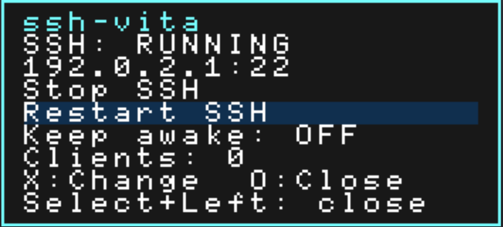

<p align="center">
  
</p>

<h1 align="center">ssh-vita</h1>

SSH and SFTP for homebrew-enabled PlayStation Vita systems.

[Third-party notices](LICENSE.md)

**Version:** 1.4.2  
**Tested firmware:** 3.65

<p align="center">
  
</p>

## Uses and examples

- Access your Vita remotely over SSH and manage files with SFTP or SCP.
- Connect an AI agent to inspect the device, run supported commands, transfer files, and check the results.
- Develop homebrew games and plugins on your computer, transfer builds to the Vita, and collect logs during testing.
- Investigate game behavior, create cheats, and modify compatible game data or save files.
- Customize supported homebrew interfaces, themes, and configuration files.
- Diagnose storage, network, application, and plugin issues by gathering system information, logs, and process details.
- Capture screenshots to document bugs, compare visual changes, or help an agent understand what is on screen.
- Send timed button, touch, and analog input for menu navigation, repeatable tests, or agent-assisted gameplay.
- Back up accessible saves and configuration files to your computer before making changes.
- Search logs, compare file checksums, and inspect large folders to troubleshoot missing or corrupted files.
- Extract ZIP, TAR, and gzip archives directly on the Vita, or fetch files from an HTTP server on your local network.
- Inspect loaded modules and use memory search/filter tools to investigate values in compatible running games.

An agent runs on your computer and uses ssh-vita to communicate with the console. Building games and plugins still requires the appropriate development tools on your computer. Game modifications, UI control, and automated gameplay depend on the application and available commands; they are not guaranteed to work with every title.

### Check the device and installed applications

Replace `USER` and `VITA_IP` with the login and address shown by ssh-vita. Replace sample file paths with files that exist on your device.

```sh
ssh USER@VITA_IP 'sysinfo; battery; df'
ssh USER@VITA_IP 'apps'
ssh USER@VITA_IP 'ps'
ssh USER@VITA_IP 'log 30'
```

### Transfer a build or retrieve a log

```sh
scp ./my-homebrew.vpk USER@VITA_IP:/ux0/data/
scp USER@VITA_IP:/ux0/data/homebrew.log ./homebrew.log
sftp USER@VITA_IP
```

Copying a VPK does not install it. Open VitaShell on the Vita to install the transferred package.

### Capture the screen and send timed input

```sh
ssh USER@VITA_IP 'awake 1800'
ssh -T USER@VITA_IP 'screenshot -' > vita-screen.bmp
ssh USER@VITA_IP 'press Cross 100'
ssh USER@VITA_IP 'tap 480 272 100'
ssh USER@VITA_IP 'awake off'
```

The capture is a BMP file. Input acts on the current screen; the example tap uses the center of the 960×544 display. Screen capture requires an available framebuffer, and some full-frame transfers may time out.

### Example requests for a connected agent

- “Check free storage, battery, and running processes, then explain anything unusual.”
- “Back up this homebrew configuration, change the requested setting, and verify the file afterward.”
- “Download this crash log and help identify why my homebrew stopped working.”
- “Build my plugin on the computer, transfer the output, and tell me what device-side steps are required.”
- “Capture the screen before and after this menu action and compare the results.”
- “Inspect this game's loaded modules and help investigate a value for a cheat.”

## Features

- SSH-2 terminal access, command execution, and SFTP file transfers.
- Optional background startup with a delayed service launcher.
- Select + D-pad Left opens a text menu from LiveArea or a game.
 <p align="center">
  
</p>
- Start, stop, and restart SSH from the menu without opening the app.
- Manual background keep-awake; OFF after every reboot.
- The app defaults to keeping its screen awake while open.
- Process and module inspection, checked memory tools, and screenshots.
- Timed button, touch, and analog commands.
- AES-CTR and ChaCha20-Poly1305 SSH ciphers.
- Archive extraction, HTTP downloads, installed-app listings, and additional text tools.
- Memory search, filtering, and timed value freezing.
- Optional saved safe memory mode, with timed write unlocking on the Vita.
- Login lockout after repeated authentication failures.

## Changes in 1.4.2

- Bound login fields and wrap connection instructions to fit the app display.
- Includes the expanded commands and optional safe memory mode introduced in 1.4.0 and 1.4.1.

## Changes in 1.4.1

- Optional safe memory mode is OFF by default and saved across reboots.
- D-pad Right toggles the mode; D-pad Left unlocks memory writes for 10 minutes.
- While enabled, the mode restricts memory ranges and operation sizes, checks memory availability for heavy commands, and protects its settings from shell and SFTP changes.
- The mapped-range check is a heuristic, not a guarantee that every memory operation is valid.

## Changes in 1.4.0

- Added AES-128-CTR and AES-256-CTR with HMAC-SHA2-256, alongside ChaCha20-Poly1305.
- Added `unzip`, `tar`, `gunzip`, `curl`, `wget`, `nc -z`, `apps`, and text utilities.
- Added `mem search`, `mem filter`, `mem results`, `mem freeze`, and `mem clear`.
- Added a 60-second address lockout after five failed logins and a default-password reminder.
- HTTP downloads accept numeric IPv4 addresses; HTTPS and DNS are not supported.

## Changes in 1.3.8

- One SSH service replaces the separate app/background controls.
- A resident menu shows the service state, address, and connected clients, with controls for SSH and background keep-awake.
- Stopping SSH leaves the menu available to start it again. Restart closes existing SSH sessions before reopening the listener.
- App screen always-on defaults to ON and does not enable background keep-awake.

## Install

1. Download the release ZIP and extract `ssh-vita.vpk`.
2. Transfer the VPK to the Vita and install it with VitaShell.
3. Open **ssh-vita**. The app displays the address, port, and login information.
4. Reboot after an upgrade so the background service and kernel helper match.

Connect using the address and login shown by the app:

```sh
ssh USER@VITA_IP
sftp USER@VITA_IP
```

## App controls

| Button | Action |
| --- | --- |
| X | Start or stop SSH |
| Up | Restart SSH |
| Down | Toggle background keep-awake ON/OFF |
| L | Install or remove automatic SSH startup |
| R | Save a screenshot |
| Select | Toggle app screen always-on (defaults ON) |
| Select + Left | Open or close the resident text menu |
| Start | Reload settings |
| Triangle | Toggle password authentication |
| Square | Generate a new password |
| Circle | Exit the app |
| D-pad Right | Toggle safe memory mode (saved; defaults OFF) |
| D-pad Left | Unlock memory writes for 10 minutes while safe memory mode is ON |

## Plugin menu

Install automatic startup with **L** in the app, then reboot after upgrading.
Press **Select + D-pad Left** from LiveArea or a game to open the text menu.
SSH runs independently of the app, including after closing it.

The menu displays SSH's current state, the device address and port, and the
number of connected clients.

| Menu item | Action |
| --- | --- |
| Start SSH / Stop SSH | Start or stop the listener; the menu remains available when SSH is stopped |
| Restart SSH | Disconnect existing clients and restart the listener |
| Keep awake: ON/OFF | Toggle background keep-awake without opening the app |

Use **Up/Down** to choose an item and **X** to apply it. Press **Circle** or
**Select + D-pad Left** again to close the menu. Menu button navigation is
filtered so it does not also move the underlying Vita interface or game.
Stopping or restarting SSH disconnects existing clients.

Background keep-awake is **OFF after every reboot**. Toggle it in the menu or
with **Down inside ssh-vita**. An explicit enable continues after leaving the
app. The app's separate screen always-on setting defaults to **ON each time
the app opens** and only applies while the app is active.

## Startup and recovery

Press **L** in the app to enable or remove automatic SSH startup. When enabled,
the service starts after a short boot delay and becomes reachable once Wi-Fi
is connected. The app does not need to be opened; closing it does not stop SSH.
Removing startup changes future boots and does not stop the current service.

Hold **D-pad Up from power-on until LiveArea appears** to skip background SSH
for that boot. The app can still be opened manually. The next normal boot
restores enabled startup. For an earlier module-loading failure, the standard
**hold L at boot** plugin bypass remains available.

Run `help` for the full command list. Memory and input tools require the matching
kernel helper. Screen capture requires an available application framebuffer.

## Third-party notices

See [Third-party notices](LICENSE.md) for the bundled components’ copyright notices and license terms.

## Disclaimer

Use ssh-vita at your own risk. This software is provided “as is,” without warranty of any kind. I (ToastedFrog2) am not responsible for damage to your device, a bricked or unbootable system, lost or corrupted files or saves, account restrictions, or other loss resulting from the use or misuse of this software, third-party tools, scripts, or AI agents connected to it.

You are responsible for the commands you run and the access you give to others or to automated tools. Back up important data before making changes. Safe memory mode and other checks reduce some risks but do not guarantee that an operation is safe or that recovery will be possible.
